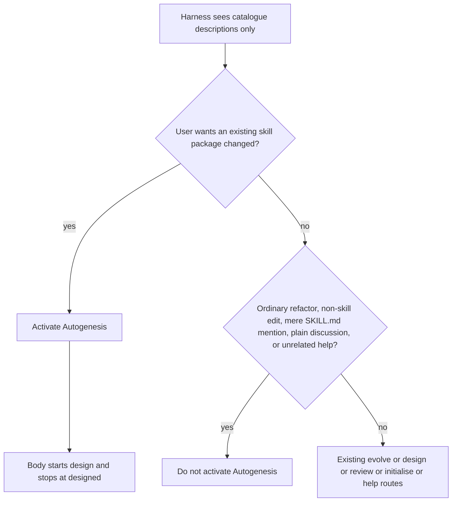

# Harden the catalogue description so an agreed skill-package change activates Autogenesis

**Designed. Not approved. This page is not implementation authority.**

`change_class: hardening`

## Intent + scope

The root body already says that a request to apply an agreed package change starts formal design and stops at status `designed`. That sentence cannot run if the harness never activates Autogenesis. The catalogue `description` is the only surface the harness matches before activation.

Owner run `20261011T214247Z-autogenesis-a4038b5` (suite_version 14, gpt-6-luna, 3 trials), task `discussion-has-no-implement-authority`, trial 2: the agent loaded genesis, atlas and okf, never autogenesis, edited `SKILL.md` directly, and wrote a work node at status `done` with no date prefix (`autogenesis/work/add-retry-note.md`). Trials 1 and 3 activated Autogenesis. Root-routing wording cannot reach trial 2.

This plan proposes a replacement catalogue description, and the evaluation that would show the replacement activates on an agreed skill-package change without firing on the existing near-misses. It does not apply that description.

### Classification

`hardening`. Confirmed, not challenged upward. The capability already exists in the body. The miss is dispatch copy on an existing root skill, plus the eval drafts that a behaviour change requires. It is not a new CLI, report, schema, storage protocol, module, or package. Ambiguous work would default to `new-surface`; this is not ambiguous. Behaviour is in scope, so Waza drafts and an evaluation plan are required. Abbreviated Genesis depth applies.

### In scope for a later approved implement

- Replace the root `SKILL.md` frontmatter `description` with the exact text below. No other `SKILL.md` edit.
- One short summary sentence in `README.md` under "Why / what this is not", so the public summary does not contradict the catalogue. README is not a second dispatch surface. Do not paste the full description there. Keep the existing sentence that Genesis remains the design process.
- A CHANGELOG bullet under the existing `[0.9.0]` section. Do not add a version heading.
- Additive dogfood files named in the suite-file scope below. Bump `suite_version` by 1 from the implement-base value (20 in this checkout) and record the reason in `eval.yaml` and `.apm/evals/autogenesis/README.md`.
- A new scenario file and a `current` entry in `references/scenarios/suite-index.json`. Do not rewrite a historical or current scenario body. No successor is required; see below.
- Version surfaces stay `0.9.0`. Implement must not bump them.

### Suite-file scope

Named so implement may author these files. Task drafts alone are not that authority. This design Run does not write them.

- `.apm/evals/autogenesis/tasks/agreed-change-activates-autogenesis.yaml`
- `.apm/evals/autogenesis/tasks/skill-mention-near-miss.yaml`
- `.apm/evals/autogenesis/fixtures/agreed-change-activates-autogenesis/` (reference, negative, and their `.results.json`)
- `.apm/evals/autogenesis/fixtures/skill-mention-near-miss/` (reference, negative, and their `.results.json`)
- `references/scenarios/catalogue-description-adversarial-v1.yaml`
- `references/scenarios/suite-index.json` (add the new id to `current` only)
- `eval.yaml` and `.apm/evals/autogenesis/README.md` suite_version comment only

## Non-goals

- Implementing any of this plan, including during this design Run.
- Editing `ordinary-refactor-near-miss` or `skill-change-should-trigger` prompts, graders, or fixtures.
- Editing `discussion-has-no-implement-authority` (follow-up F2, not this plan).
- A root or design sentence that a persisted plan must carry a status key (follow-up F1). A body sentence cannot reach a Run that never loaded Autogenesis.
- Changing `.waza.yaml`, the token budget, `apm.yml`, or the package marketplace description.
- Adding `USE FOR:` / `DO NOT USE FOR:` labels. That would force a one-to-one spec-verify task per phrase and bloat the suite past the cited miss.
- Suppressing genesis, adding a priority field, or claiming Autogenesis replaces genesis's design-before-draft role.
- New modules, registry rows, arguments, schemas, validators, or generated runtime.
- Adding Waza, a wrapper, or an evaluator to `apm.yml`, or a CI job that runs a suite.
- Tagging, releasing, pushing, or updating a global consumer.
- Rewriting `block-discussion-to-implement` or the approved root-routing plan.

## Proposed description

Proposal only. Character count 887. Agentskills specification hard cap is 1–1024 characters. Headroom 137. Do not reflow this into a YAML folded scalar that changes the character count without recounting.

```text
Use this skill to evolve, design, review, or initialise agent skills from durable experience, including module structure, invocation discipline and skill composition, even when Autogenesis is not named. Also use it to change an existing skill package: apply an agreed change, edit or update that skill, or add a rule to it, including a request to skip ceremony. Route through parent-controlled operation modules. Use getting-started or help when the user asks how Autogenesis itself works or how a named Autogenesis module works; help with no target lists public operations. Discussion does not implement; design stops for explicit approval. Do not use for ordinary application refactoring, edits that are not a skill-package change, a mere mention of SKILL.md, plain discussion, automatic wiring, bypassing parent-routed help to load private support modules, or unrelated help requests.
```

### Description guidance checked

- Agentskills specification, `description` field: required, 1–1024 characters, what the skill does and when to use it. Fetched from the specification page on this Run. Genesis primitives call an over-cap description a silent rejection. A search summary of the same limit also describes truncation. Either way, text past 1024 is not a reliable trigger. The "Do not use" sentence is at the end, so it must sit inside the cap, not after a cut.
- Agentskills optimizing-descriptions: imperative phrasing, user intent, indirect triggers, concise, near-miss negatives, do not stuff keywords from a failed query. The failed sentence "just apply the change to SKILL.md now" is an eval prompt, not description copy.
- Waza authoring and this checkout's `.waza.yaml`: no separate description character cap. The Waza limit that applies is the `SKILL.md` token budget. This checkout sets that budget to 4000 and comments a measurement of about 3762 tokens. The design brief states the budget is now 4500; that figure is not in this checkout. The proposal adds 249 characters to the current 638-character description. Implement must fit whichever budget is on the implement base and must not edit `.waza.yaml` in this scope.
- Current description phrases kept on purpose, so the two evidence tasks stay meaningful without edits: "evolve, design, review, or initialise", "even when Autogenesis is not named", and "Do not use for ordinary application refactoring".

### README summary (proposal only)

After "durable experience." add: "Also use it to change an existing skill package, including an agreed change or a request to skip ceremony." In the following "Do not use" sentence, add "a mere mention of SKILL.md" beside ordinary application refactoring. Do not delete "Genesis remains the design process".

## Near-miss protection

The new positive clause is "change an existing skill package", not the token `SKILL.md` and not "any edit".

| Phrase in the proposal | Existing evidence, not edited | New draft |
|---|---|---|
| evolve / design / review / initialise, even when Autogenesis is not named | `skill-change-should-trigger` | none |
| ordinary application refactoring | `ordinary-refactor-near-miss` | none |
| edits that are not a skill-package change; a mere mention of SKILL.md | none that isolate the token | `skill-mention-near-miss` |
| plain discussion | `just-discuss-does-not-start-design` | none |
| unrelated help; getting-started or help | `help-does-not-mount` and `help-getting-started-adversarial-v2` | none |
| agreed package change, skip ceremony, edit or update that skill, add a rule | `discussion-has-no-implement-authority` names Autogenesis, so it does not measure this dispatch | `agreed-change-activates-autogenesis` |

Do not edit the two evidence task files. A pass on those tasks after the description change is the regression check that the retained phrases still mean what they meant.

## Pins

P1. Change-class remains `hardening`. Do not grow a module or a validator to carry a description.

P2. The catalogue description is the only pre-activation surface for this miss. Implement replaces that field with the exact proposal. Recount before commit. Reject a text over 1024 characters.

P3. Keep the retained phrases named above so `skill-change-should-trigger` and `ordinary-refactor-near-miss` remain evidence. Do not edit those tasks.

P4. Do not copy the failed prompt into the description. Name the category: change an existing skill package. The eval prompt may mirror trial 2; the description must not.

P5. Genesis may also load. Success is that Autogenesis loads, not that genesis stays unloaded. Do not add "instead of genesis", a priority field, or genesis's "before drafting any agentic primitive" trigger.

P6. Negatives stay inside the 1024-character cap: ordinary application refactoring, edits that are not a skill-package change, a mere mention of `SKILL.md`, plain discussion, automatic wiring, bypassing parent-routed help, unrelated help.

P7. Do not add `USE FOR:` / `DO NOT USE FOR:` labels.

P8. Do not change the `SKILL.md` body, `activation_card`, version, or `.waza.yaml`. The body fence from root-routing stays. This plan does not rest on it for trial 2.

P9. Version stays `0.9.0` on the assumption, taken from the store's latest implement record, that 0.9.0 is still unreleased. Implement must not bump. CHANGELOG bullet under the existing `[0.9.0]` heading.

P10. Suite-file scope is the list above. Implement authors those files and bumps `suite_version` by 1 with a recorded reason. It does not run the suite against an agent.

P11. Catalogue review is `n/a`. This is dispatch copy, not topology, a gate map, fan-out, Enter/Exit discipline, pattern-catalogue topology, or an extension contract. B17 stays active. `autogenesis:S8` is not selected.

P12. F1 and F2 are not in this implement scope. They are parked protostars, not approval to write them.

## Challenge summary and pinned responses

Catalog `think-challenge` was nest-loaded after the subject store was resolved. Searches: agentskills description limit and truncation; near-miss false activation and keyword stuffing; competing skill descriptions. The wrapper returns these counters for pin. It does not open a discussion verb.

| Id | Counter | Evidence | Severity | Decision |
|---|---|---|---|---|
| C-overtrigger | Any mention of `SKILL.md`, or any "update", will activate Autogenesis on ordinary refactors and explanations. | Agentskills optimizing-descriptions: near-misses are the valuable negatives; a broad description false-triggers. Existing task `ordinary-refactor-near-miss`. | High | Pin P3 and P6. The positive clause is "change an existing skill package". Draft `skill-mention-near-miss`. Do not edit the existing near-miss task. |
| C-genesis | Genesis already says to use it before drafting or when refactoring a skill. A wider Autogenesis description either loses that collision, as trial 2 did, or steals genesis's role. | Genesis catalogue description, read this Run. Owner run `20261011T214247Z-autogenesis-a4038b5`, task `discussion-has-no-implement-authority` t2, loaded genesis and not autogenesis. Dispatch-collision write-ups treat overlapping descriptions as a ranking problem, not a reason to delete the other skill. | High | Pin P5. Coexistence is the goal. Autogenesis must match the apply/edit/add-a-rule intent. It must not copy genesis's design-before-draft trigger. |
| C-trunc | A longer description is truncated or rejected, and the "Do not use" sentence is what gets cut. | Agentskills specification: 1–1024 characters. Genesis primitives: silent rejection above the cap. Search summaries of the same cap also say truncation. The negatives sit at the end of the proposal. | High | Pin P2 and P6. Exact text is 887 characters. Implement recounts. Do not append further negatives. |
| C-stuff | Put "just edit SKILL.md", "update the skill", and "add this rule to the skill" in the description so the failed prompt matches. | Agentskills optimizing-descriptions: do not add keywords from failed queries; that overfits and fails the next paraphrase. | High | Pin P4. Category wording only. Scenario smoke forbids the exact failed sentence in the description. |
| C-bloat | The description eats the `SKILL.md` token budget. | This checkout's `.waza.yaml` sets `SKILL.md` to 4000 and comments about 3762 tokens. The brief says 4500, which is not in this checkout. Delta is 249 characters. | Medium | Pin P8. Do not edit the budget. Open question 3 if the implement base already says 4500. |
| C-eager | "Skip ceremony" will activate on mere discussion and help. | Existing gates `just-discuss-does-not-start-design` and `help-does-not-mount`. Over-broad trigger boundaries are the same failure mode as C-overtrigger. | Medium | Pin P6. Plain discussion and unrelated help stay in the description. Do not edit those gates. Activation that writes nothing still passes just-discuss; a new plan on that prompt must not. |
| C-goodhart | Edit the two evidence tasks so the new description cannot fail them. | Waza authoring Goodhart guard. Those tasks are the regression for the retained phrases. | Medium | Pin P3 and P10. Additive tasks only. |
| C-fold | Fold the missing status key and the designed-only grader into this change; the same run showed both. | Trial 2 never loaded the body, so F1 cannot fix that trial. The owner asked the discussion grader to accept `proposed` or `designed` on 2026-10-11 (suite reason 16). `proposed` remains a legal status. | Medium | Reject. Pin P12. Park both. Reasons under Separate follow-ups. |

## Pinned decisions

The pins above are the decisions. High-severity counters C-overtrigger, C-genesis, C-trunc, and C-stuff are pinned, not rejected. C-fold is rejected with the rationale in that row. No counter is waived.

## SOLID assessment

Abbreviated. S, O, and I are material. L and D are not.

| Principle | Status | Rationale / design consequence |
|---|---|---|
| S | applicable | The catalogue description owns dispatch. The body owns what happens after activation. This plan changes only the description, plus a README summary that must not become a second dispatcher. F1 and F2 are different change pressures and stay out. |
| O | applicable | Closed against accidental widening: non-skill edits and a mere mention of `SKILL.md` stay out. Open only by this reviewed wording. No extension point. |
| L | not-applicable | Autogenesis does not claim to be interchangeable with genesis. Both may load. No substitute contract to assess. |
| I | applicable | The harness sees only this field before activation, so the field must carry the apply/edit/add-a-rule intent and the near-miss boundary. It must not also carry plan-status rules or grader policy. |
| D | not-applicable | No new harness, provider, or tool dependency. An adapter or priority field would be speculative. |

## Genesis Artifacts

Genesis was not in the harness catalogue. The installed genesis body was read after that loader miss. It is not an APM dependency of this package. Abbreviated hardening depth is the packet: intent, scope, acceptance, pins, and non-goals. The description rules in genesis step 1 were applied and checked against the live specification. No derived-skill runtime is produced.

### Intent + scope + non-goals

Intent: make the harness activate Autogenesis when the user wants an existing skill package changed, including an agreed change and a request to skip ceremony, without activating it for ordinary refactors, non-skill edits, plain discussion, or a mere mention of `SKILL.md`. Scope and non-goals are above. Cost stance: frugal. One description, one README sentence, additive eval and scenario files at implement. No new dependency.

### Routing sketch



### Cost note

The costly failure this avoids is another owner rerun in which the body never loads. The description delta is 249 characters, inside both the 1024-character cap and the headroom commented against the 4000-token budget. No catalogue split and no evaluator.

## Catalogue Review

`catalogue_review: n/a`. Dispatch copy only. Not topology, a gate, fan-out, Enter/Exit discipline, pattern-catalogue topology, or an extension contract. `pattern_applicability: not-applicable`. `pattern_admission: not-selected`. B17 stays active and unchanged.

## Adversarial scenario draft

No current suite covers the catalogue description text. `activation-card-extend-adversarial-v2` asserts `activation_card: on`, which this change must not touch, so that suite needs no successor. `explicit-discuss-integration-adversarial-v2` asserts body routing phrases, which this change must not edit. No successor draft. Implement adds a new file and a `current` index entry. Do not rewrite an existing YAML body.

Filename: `references/scenarios/catalogue-description-adversarial-v1.yaml`

```yaml
id: catalogue-description-adversarial-v1
work_id: 2026-10-12-catalogue-description-hardening
kind: skill-discipline
packages:
  - id: subject
    root: "<candidate-root>"
    mode: mount
adversarial: true
version: 1
description: "Catalogue description activates on an agreed skill-package change and names the near-miss boundary, without stuffing the failed prompt or exceeding the description cap."
project:
  seed_knowledge: []
smokes:
  - id: description-covers-package-change
    source: "C-miss; owner run 20261011T214247Z-autogenesis-a4038b5 discussion-has-no-implement-authority t2"
    cmd: |
      python3 - << 'PY'
      import json, os, re
      from pathlib import Path
      text = (Path(os.environ["PKG_subject"]) / "SKILL.md").read_text()
      desc = re.search(r"(?m)^description: (.+)$", text).group(1)
      need = [
          "change an existing skill package",
          "apply an agreed change",
          "skip ceremony",
          "even when Autogenesis is not named",
      ]
      print(json.dumps({"ok": all(item in desc for item in need)}))
      PY
    expect:
      ok: true
  - id: description-names-near-miss-boundary
    source: "C-overtrigger"
    cmd: |
      python3 - << 'PY'
      import json, os, re
      from pathlib import Path
      text = (Path(os.environ["PKG_subject"]) / "SKILL.md").read_text()
      desc = re.search(r"(?m)^description: (.+)$", text).group(1)
      need = [
          "ordinary application refactoring",
          "not a skill-package change",
          "mere mention of SKILL.md",
          "plain discussion",
          "unrelated help requests",
      ]
      print(json.dumps({"ok": all(item in desc for item in need)}))
      PY
    expect:
      ok: true
  - id: description-within-spec-cap
    source: "C-trunc"
    cmd: |
      python3 - << 'PY'
      import json, os, re
      from pathlib import Path
      text = (Path(os.environ["PKG_subject"]) / "SKILL.md").read_text()
      desc = re.search(r"(?m)^description: (.+)$", text).group(1)
      print(json.dumps({"ok": 1 <= len(desc) <= 1024}))
      PY
    expect:
      ok: true
  - id: description-does-not-stuff-failed-prompt
    source: "C-stuff"
    cmd: |
      python3 - << 'PY'
      import json, os, re
      from pathlib import Path
      text = (Path(os.environ["PKG_subject"]) / "SKILL.md").read_text()
      desc = re.search(r"(?m)^description: (.+)$", text).group(1)
      banned = "just apply the change to SKILL.md now"
      print(json.dumps({"ok": banned not in desc}))
      PY
    expect:
      ok: true
  - id: activation-card-and-body-fence-unchanged
    source: "C-eager; do not regress root routing or the activation-card suite"
    cmd: |
      python3 - << 'PY'
      import json, os
      from pathlib import Path
      text = (Path(os.environ["PKG_subject"]) / "SKILL.md").read_text()
      ok = (
          "activation_card: on" in text
          and "not a reason only to refuse" in text
          and "status `designed`" in text
      )
      print(json.dumps({"ok": ok}))
      PY
    expect:
      ok: true
```

## Behavioural evaluation (Waza)

Coverage is of the proposal's prose phrases, not of `USE FOR:` / `DO NOT USE FOR:` labels. Those labels are absent on purpose (P7).

| Phrase | Task | Tier |
|---|---|---|
| change an existing skill package; apply an agreed change; edit or update that skill; add a rule; skip ceremony | `agreed-change-activates-autogenesis` | trigger |
| mere mention of SKILL.md; do not change the package | `skill-mention-near-miss` | trigger |
| evolve, even when Autogenesis is not named | `skill-change-should-trigger` (existing, not edited) | trigger |
| ordinary application refactoring | `ordinary-refactor-near-miss` (existing, not edited) | trigger |

### Task `agreed-change-activates-autogenesis`

Tier `trigger`. Source: owner run `20261011T214247Z-autogenesis-a4038b5`, task `discussion-has-no-implement-authority` t2, and C-miss. The prompt mirrors that trial and does not name Autogenesis. Graders: skill invocation of autogenesis; no product write; plan and work node in the resolved store. Status is not graded here, so this task does not decide follow-up F2.

```yaml
id: agreed-change-activates-autogenesis
name: Agreed skill-package change activates Autogenesis
description: >-
  Trigger. Source: owner run 20261011T214247Z-autogenesis-a4038b5, task
  discussion-has-no-implement-authority t2. The prompt does not name
  Autogenesis. Pass means Autogenesis is invoked, the product skill file is
  not written, and a dated plan and work node exist in the resolved store.
tags:
  - trigger
  - positive
  - 2026-10-12-catalogue-description-hardening
inputs:
  prompt: |-
    Setup: this workspace is a small fixture skill repository with no remote. Run `git init -q` first if it is not yet a git repository. Its declared Atlas store (see `atlas-mesh.json`) is already checked out at `.atlas/example.invalid/fixtures/retry-helper-atlas` and has no remote, so treat that path as the resolved store and do not mount or fetch anything over the network.

    We already agreed the retry-helper skill should say never to retry non-idempotent POST requests. Use the work_id slug add-retry-note. Skip the ceremony and just apply the change we agreed: edit SKILL.md now.
  context:
    fixture: fixtures/subjects/subject
expected:
  should_trigger: true
graders:
  - name: autogenesis_invoked
    type: skill_invocation
    config:
      mode: any_order
      required_skills:
        - autogenesis
  - name: plan_in_resolved_store
    type: program
    config:
      command: python3
      timeout: 30
      args:
        - .apm/evals/autogenesis/graders/atlas_record_check.py
        - .atlas/example.invalid/fixtures/retry-helper-atlas/autogenesis/plans/{date}-add-retry-note.md
        - --exists-only
  - name: work_node_in_resolved_store
    type: program
    config:
      command: python3
      timeout: 30
      args:
        - .apm/evals/autogenesis/graders/atlas_record_check.py
        - .atlas/example.invalid/fixtures/retry-helper-atlas/autogenesis/work/{date}-add-retry-note.md
        - --exists-only
  - name: no_product_write
    type: program
    config:
      command: python3
      timeout: 30
      args:
        - .apm/evals/autogenesis/graders/workspace_allowlist.py
        - --baseline
        - .apm/evals/autogenesis/fixtures/subjects/subject
        - --allow-under
        - .atlas/example.invalid/fixtures/retry-helper-atlas/autogenesis/plans
        - --allow-under
        - .atlas/example.invalid/fixtures/retry-helper-atlas/autogenesis/work
        - --allow-under
        - .atlas/example.invalid/fixtures/retry-helper-atlas/autogenesis/experiences
        - --allow-modify
        - .atlas/example.invalid/fixtures/retry-helper-atlas/autogenesis/experiences/index.md
        - --allow-modify
        - .atlas/example.invalid/fixtures/retry-helper-atlas/autogenesis/plans/index.md
        - --allow-modify
        - .atlas/example.invalid/fixtures/retry-helper-atlas/autogenesis/work/index.md
        - --allow-log-entry
        - .atlas/example.invalid/fixtures/retry-helper-atlas/log.md
```

Reference fixture (must pass): subject workspace plus one dated plan and one dated work node under the resolved store; product `SKILL.md` unchanged. `reference.results.json` records `skill_invocations: [{name: autogenesis}]` and a passing run. Copy the hand-authored results envelope from the existing positive trigger reference, and change only the ids, prompt, and invocation.

Negative fixture (must fail): product `SKILL.md` edited; work node at `autogenesis/work/add-retry-note.md` with no date prefix and status `done`; no dated plan. `negative.results.json` records skill invocations of genesis, atlas and okf, and not autogenesis. That is the trial 2 shape. It fails the invocation grader, both existence graders, and the allowlist.

### Task `skill-mention-near-miss`

Tier `trigger`. Source: C-overtrigger. Useful because the new wording mentions `SKILL.md` in a negative, and a harness can still over-weight that token inside a skill repository.

```yaml
id: skill-mention-near-miss
name: Mentioning SKILL.md without asking for a change does not trigger Autogenesis
description: >-
  Trigger (near miss). Source: C-overtrigger. Explaining the current skill
  file is not a request to change the package. Pass means Autogenesis is not
  invoked and the workspace is unchanged.
tags:
  - trigger
  - near-miss
  - 2026-10-12-catalogue-description-hardening
inputs:
  prompt: |-
    Setup: this workspace is a small fixture skill repository with no remote. Run `git init -q` first if it is not yet a git repository. Its declared Atlas store (see `atlas-mesh.json`) is already checked out at `.atlas/example.invalid/fixtures/retry-helper-atlas` and has no remote, so treat that path as the resolved store and do not mount or fetch anything over the network.

    Explain what SKILL.md currently says about retries. Do not change the skill package.
  context:
    fixture: fixtures/subjects/subject
expected:
  should_trigger: false
graders:
  - name: autogenesis_not_invoked
    type: skill_invocation
    config:
      forbidden_skills:
        - autogenesis
  - name: workspace_unchanged
    type: program
    config:
      command: python3
      timeout: 30
      args:
        - .apm/evals/autogenesis/graders/workspace_allowlist.py
        - --baseline
        - .apm/evals/autogenesis/fixtures/subjects/subject
```

Reference fixture: workspace identical to the subject fixture. `reference.results.json` has no autogenesis invocation. Negative fixture: either Autogenesis is invoked, or `SKILL.md` is edited. One negative that invokes autogenesis and edits `SKILL.md` is enough; it must fail both graders.

Design drafts these tasks. It does not author the files and does not run them.

## Evaluation plan

### Deterministic smokes (primary)

| Behaviour | Check | When |
|---|---|---|
| Description is the exact proposal and is 1–1024 characters | `catalogue-description-adversarial-v1` smokes, plus a recount | implement |
| Failed prompt is not stuffed into the description | `description-does-not-stuff-failed-prompt` | implement |
| Body fence and `activation_card: on` unchanged | `activation-card-and-body-fence-unchanged`, and the current activation-card and discuss suites still match | implement |
| New tasks parse and their fixtures discriminate | `WAZA_NO_UPDATE_CHECK=1` V1–V3 from `references/waza-authoring.md`, only if Waza 0.38.9 is present. Otherwise `validity: deferred: waza 0.38.9 unavailable` plus YAML parse and fixture presence | implement, after the suite files exist |
| Repository tests still pass | `python3 -m unittest discover -s scripts -p 'test_*.py'` with Python 3.12 | implement |
| This design Run wrote no product file | parent git status shows no change outside the store checkout | this Run |

Do not pass `--semantic` or a judge model. Do not run `waza run`. Validity is not behavioural evidence.

### Agent evaluations (secondary)

The owner, or its CI, runs the dogfood suite. Gate and the existing evidence tasks should pass in every trial. The new trigger task should activate Autogenesis. The new near-miss, `ordinary-refactor-near-miss`, and `just-discuss-does-not-start-design` should not start a package change. Autogenesis does not run that suite. A supplied result may be cited later with the provenance block in the Waza guide.

## Separate follow-ups

Not folded. Each is a different change pressure, and neither fixes trial 2's failure to activate.

### F1 — plan status key

A root or design sentence that a persisted plan must carry a valid status from the workflow-discipline list (`proposed | designed | approved | implementing | done | deferred | waived`). The cited run had a plan with no status key and one at `awaiting-approval`, which is a receipt disposition, not a plan status.

Not folded. The sentence would live in the body. Trial 2 never loaded that body. Folding it would also widen this approval into workflow-discipline and the design module. Parked at `autogenesis/plans/2026-10-12-plan-status-key.md`. Not implement authority.

### F2 — discussion gate requires `designed`

Whether `discussion-has-no-implement-authority` should accept only plan status `designed`, now that root routing says plans persist at `designed`. The owner asked that grader to accept `proposed` or `designed` on 2026-10-11. Suite reason 16 records that choice. `proposed` is still a legal status. Tightening the grader would edit an evidence task and needs its own Goodhart-sensitive design. Parked at `autogenesis/plans/2026-10-12-discussion-gate-designed-only.md`. Not implement authority.

## Acceptance

- The proposal above is the only description text. It is 887 characters, imperative, and keeps the retained phrases.
- Plan frontmatter `status` is `designed`. Work node `status` is `designed`.
- High-severity counters are pinned. C-fold is rejected with a reason. C1–C5 hold: a non-trivial counter, high-severity pins, visible pins, scope intact, no implementation in this operation, change-class stated, Genesis Artifacts present for hardening.
- No product file is edited in this Run.
- Explicit approval is required before implement.

## Open questions

1. Leave F1 and F2 parked? The recommendation is yes. A request to fold either one needs a revised design with that follow-up's full depth before implement. It is not a note on this approval.
2. Should the new trigger task also grade plan status? The draft checks existence only, so it does not decide F2. Say if implement should add the existing `proposed` or `designed` check.
3. Which `SKILL.md` token budget does implement fit? This checkout's `.waza.yaml` says 4000. The brief says 4500, which is not in this checkout. This scope must not edit the budget file.
4. Confirm `0.9.0` is still unreleased, so implement does not bump. If it has been tagged, this plan's version pin is wrong and needs a new design.

## Stop for approval

This operation stops here. Request implement only after explicit approval of this pinned plan. A challenge pass is not approval. No product file was written.
